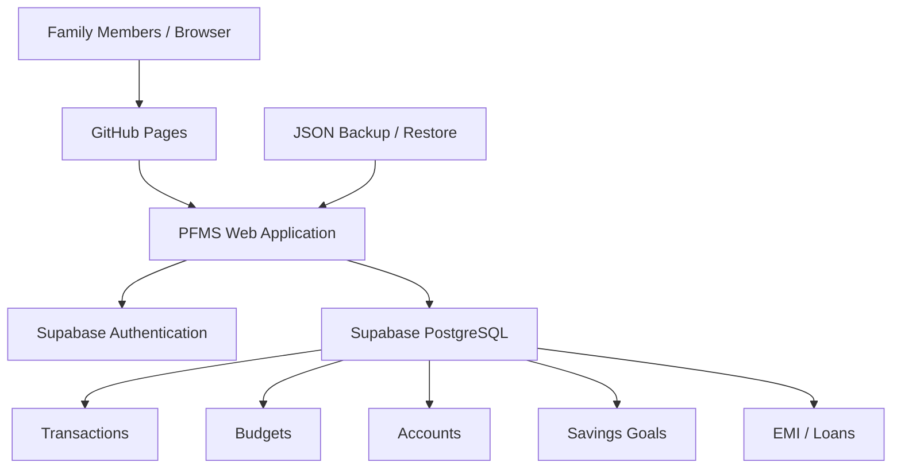

# PFMS Application Architecture

## Overview

PFMS (Personal Financial Management System) is a web-based family finance management application designed to track household income, expenses, budgets, savings goals and financial activities.

The application uses a static web frontend hosted on GitHub Pages with Supabase providing the central backend and PostgreSQL database.

## Architecture

## Components

### Frontend

- Web-based application.
- Hosted through GitHub Pages.
- Browser-based user interface.
- Financial transaction management.
- Budget tracking and reporting.
- JSON backup and restore functionality.

### Supabase Authentication

- Cloud-based authentication.
- Application access through authenticated users.
- User roles and permissions integrated with backend security.

### PostgreSQL Database

Supabase PostgreSQL provides central data storage for application records, including:

- Transactions
- Accounts
- Budgets
- Recurring bills
- EMIs
- Savings goals
- Opening balances

### Data Access and Security

- Row Level Security (RLS) is used to restrict access to database records.
- Database permissions are intended to separate administrative and entry-level access.
- Database-side security controls are used to enforce access restrictions.

### Backup and Recovery

- JSON backup and restore functionality.
- Exportable financial records.
- Independent backup files for recovery.
- Backup recommendations for maintaining copies in multiple locations.

## Data Flow

1. Family members access the application through a web browser.
2. The application authenticates users through Supabase.
3. Authenticated users access permitted records through the backend.
4. Supabase PostgreSQL stores central financial records.
5. Database security policies control access.
6. Users can export JSON backups for recovery.

## Technology Stack

- HTML
- CSS
- JavaScript
- GitHub Pages
- Supabase
- PostgreSQL
- Row Level Security (RLS)

## Security Considerations

- Authentication-based access.
- Database-level access restrictions.
- Row Level Security.
- Role-based access concepts.
- Backup and recovery support.
- Avoid exposing privileged Supabase credentials in frontend code.

